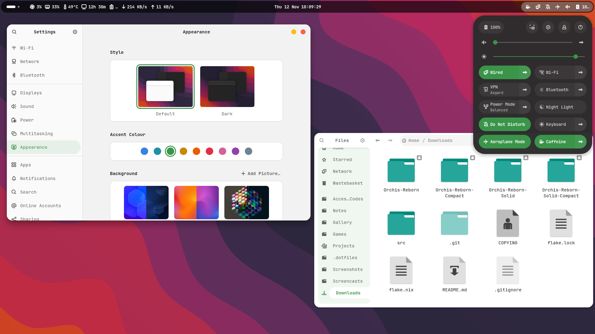
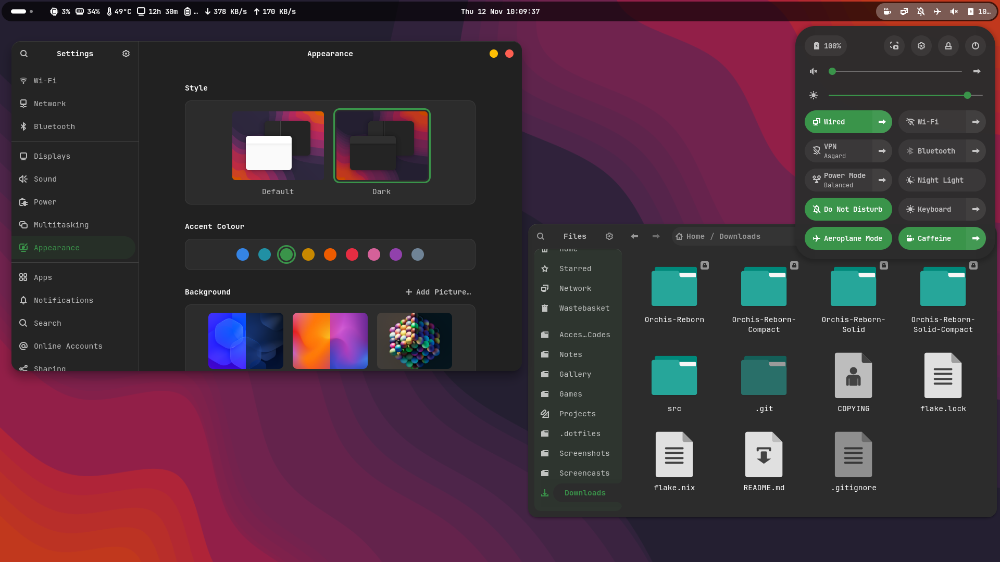
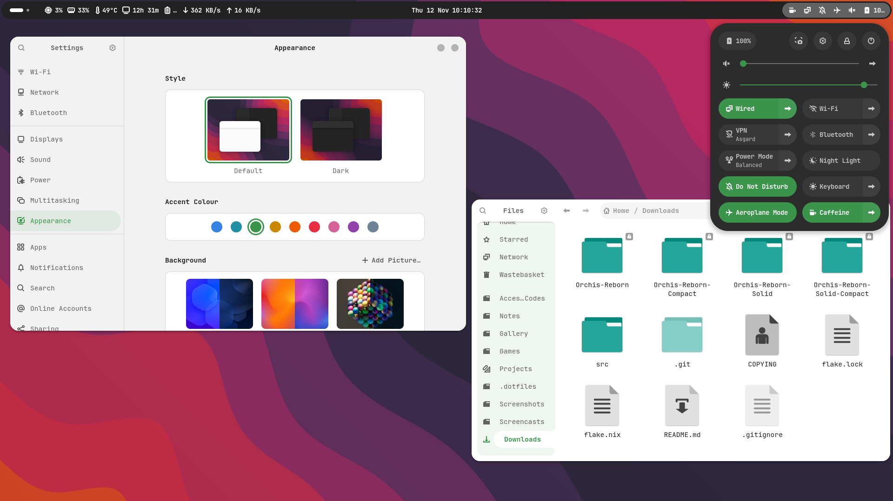
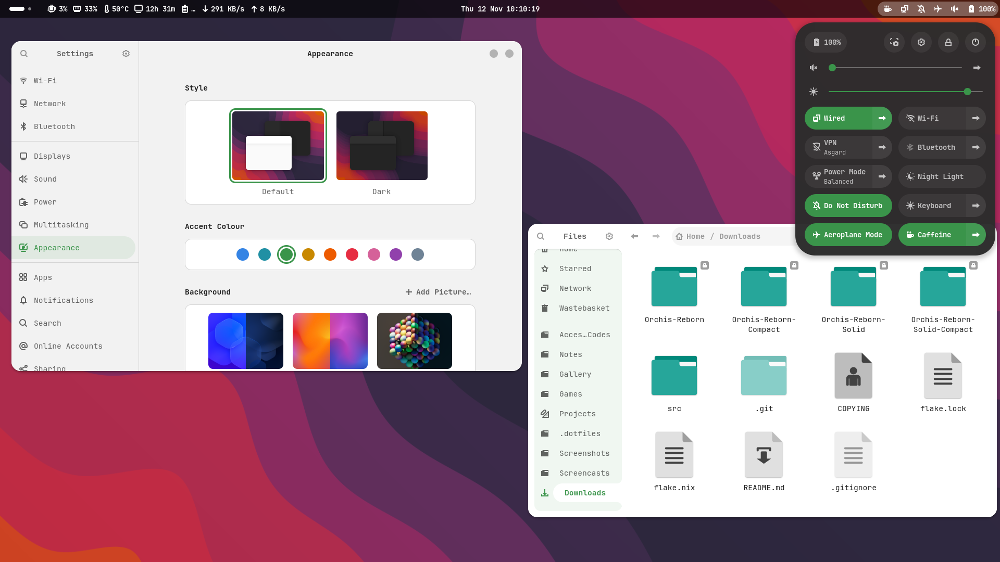
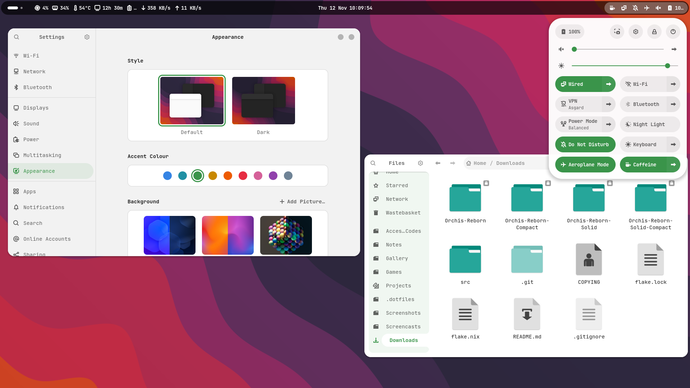

# Orchis Reborn theme

Orchis Reborn, based on [Orchis by vinceliuice](https://github.com/vinceliuice/Orchis-theme),
is a [Material Design](https://material.io) theme for GNOME/GTK based desktop
environments.





Supports GTK 4.20+ / libadwaita and GNOME Shell 51.

## Variants

| Variant                             | Opacity     | Panel    | Shell popups |
| ----------------------------------- | ----------- | -------- | ------------ |
| `Orchis-Reborn`                     | transparent | floating | dark         |
| `Orchis-Reborn-Solid`               | solid       | floating | dark         |
| `Orchis-Reborn-Compact`             | transparent | compact  | dark         |
| `Orchis-Reborn-Solid-Compact`       | solid       | compact  | dark         |
| `Orchis-Reborn-Light`               | transparent | floating | light        |
| `Orchis-Reborn-Solid-Light`         | solid       | floating | light        |
| `Orchis-Reborn-Compact-Light`       | transparent | compact  | light        |
| `Orchis-Reborn-Solid-Compact-Light` | solid       | compact  | light        |

### Solid



### Compact



### Light



## Install

### Releases

You can download the latest stable release [here](https://github.com/TA-Solaris/Orchis-Reborn-theme/releases).

### With Nix

Flake input is a follows:

```nix
{
  inputs.orchis-reborn.url = "github:TA-Solaris/Orchis-Reborn-theme";
}
```

For Home-manager:

```nix
{ inputs, pkgs, ... }: {
  home.packages = [ inputs.orchis-reborn.packages.${pkgs.system}.Orchis-Reborn ];
  gtk.theme.name = "Orchis-Reborn";
}
```

Use any of the eight package attrs listed above. `default` / `all` bundle every
variant. Select the same name in GNOME's User Themes extension to apply its
Shell styling; changing `gtk.theme.name` alone does not select a Shell theme.

### Build directly

```sh
nix build github:TA-Solaris/Orchis-Reborn-theme#Orchis-Reborn
```

Output lands at `result/share/themes/Orchis-Reborn`.

### Build release archives

From the repository root:

```sh
nix run .#build-releases
```

Builds all eight variants and writes one `.tar.gz` per variant directly into
`out/`, a regular directory. Each archive contains its named theme directory
with the actual files, ready to extract. Running again replaces matching archives.

